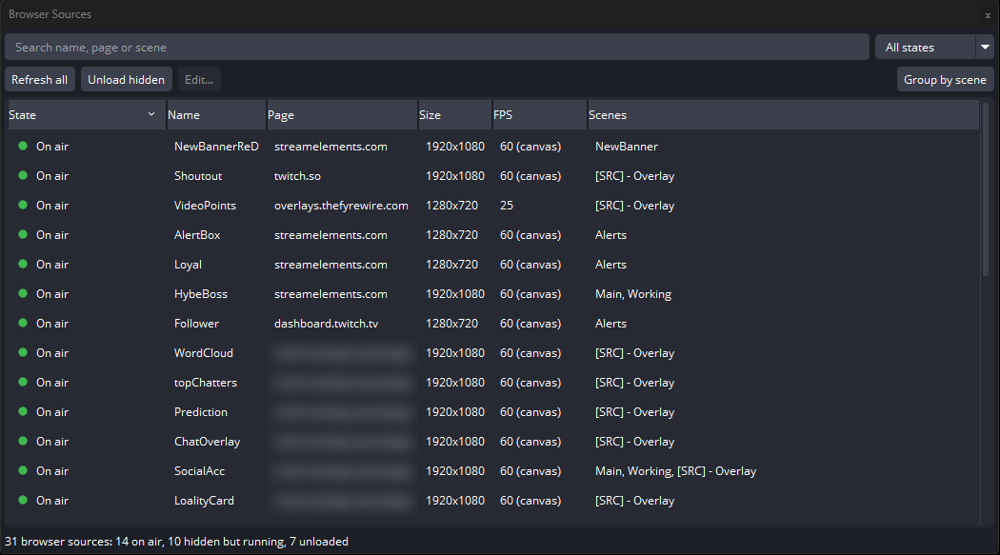
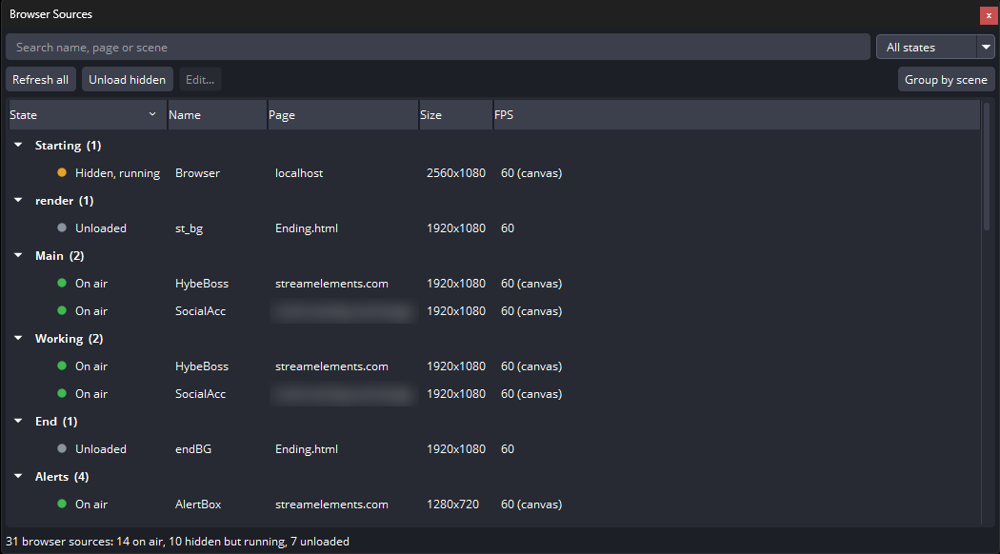
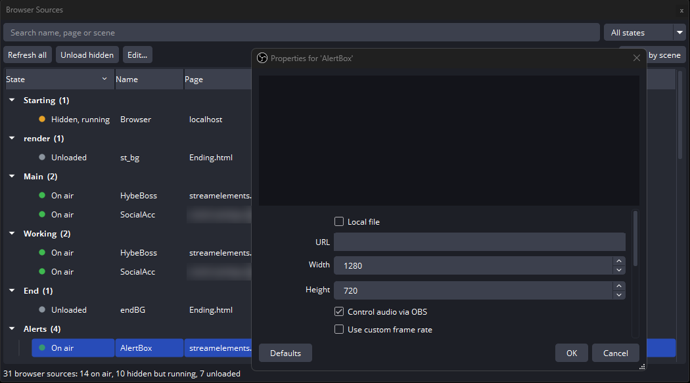

<div align="center">

# Browser Source Manager

**One dock to see and control every browser source in OBS.**

`v1.1.0` &nbsp;·&nbsp; Added 31 Oct 2026

[](https://github.com/Moh-01/BrowserSourceManager/releases/latest)  

<p align="center"></p>

Part of [My OBS Plugins](https://github.com/Moh-01/MyObsPlugins)

</div>

---

## Why

Every browser source runs its own web browser. Hidden ones keep using CPU, GPU and memory unless *Shutdown source when not visible* is on, and OBS has no single place to see which ones are doing that.

---

## Features

- **One list**: name, website, size, FPS and scenes for every browser source
- **Live state**: updated every second, with a summary count
- **Group by scene**: show the list under each scene, in your scene order
- **Search and filter**: by name, website, scene or state
- **Refresh all**: reload every page at once, bypassing the cache
- **Unload hidden**: stop every hidden source from using resources, without touching anything on air
- **Bulk edit**: change size, FPS and other settings on many sources, or a whole scene, at once
- **Private**: shows only the website name, never full URLs or overlay keys

| Dot | State | Meaning |
| :-: | :--- | :--- |
| Green | **On air** | Shown in the program output |
| Blue | **Preview** | Shown in the studio mode preview or a projector |
| Orange | **Hidden, running** | Not shown, but still loaded and using resources |
| Gray | **Unloaded** | Not shown, and shut down until it is shown again |

<div align="center">
<table>
  <tr>
    <td align="center"><br><sub>Group by scene</sub></td>
    <td align="center"><br><sub>Double-click opens properties</sub></td>
  </tr>
</table>
</div>

---

## Install

### Option 1: Install script (recommended)

**Before you run it, make sure:**

1. OBS Studio 31 or newer (64-bit) is installed
2. OBS is closed
3. You are connected to the internet

**Run it.** Open PowerShell (Start > type `PowerShell` > Enter) and paste:

```powershell
irm https://raw.githubusercontent.com/Moh-01/BrowserSourceManager/main/scripts/Install.ps1 | iex
```

Or download [Install.ps1](https://raw.githubusercontent.com/Moh-01/BrowserSourceManager/main/scripts/Install.ps1) (right-click > Save link as), then right-click the file > **Run with PowerShell**.

**What the script does:**

1. Downloads the latest release
2. Extracts it into `%ProgramData%\obs-studio\plugins\browser-source-manager`
3. Replaces any older version, so running it again updates the plugin

Then start OBS and open **Docks > Browser Sources**.

### Option 2: Manual

<details>
<summary>Show manual steps</summary>

1. Download `browser-source-manager-<version>-windows-x64.zip` from [Releases](https://github.com/Moh-01/BrowserSourceManager/releases/latest)
2. Close OBS
3. Open File Explorer, paste `%ProgramData%\obs-studio\plugins` into the address bar and press Enter (create the `plugins` folder if it is missing)
4. Extract the zip into that folder. You should end up with:
   ```
   C:\ProgramData\obs-studio\plugins\browser-source-manager\bin\64bit\browser-source-manager.dll
   C:\ProgramData\obs-studio\plugins\browser-source-manager\data\locale\en-US.ini
   ```
5. Start OBS and open **Docks > Browser Sources**

</details>

### Uninstall

<details>
<summary>Show uninstall steps</summary>

- **Script:** close OBS, then run
  ```powershell
  & ([scriptblock]::Create((irm https://raw.githubusercontent.com/Moh-01/BrowserSourceManager/main/scripts/Install.ps1))) -Uninstall
  ```
- **Manual:** close OBS and delete `%ProgramData%\obs-studio\plugins\browser-source-manager`

</details>

---

## How to use

Open **Docks > Browser Sources**.

| To | Do this |
| :--- | :--- |
| Reload every page | **Refresh all** |
| Unload everything that is hidden | **Unload hidden** |
| Reload one page | Right-click > **Refresh page** |
| Open its settings | Double-click, or right-click > **Properties** |
| Click inside the page | Right-click > **Interact** |
| Unload one source while hidden | Right-click > **Shutdown when not visible** |
| Copy or open the URL | Right-click > **Copy URL** or **Open in web browser** |
| Group the list by scene | **Group by scene** |
| Change settings on several sources | Select them > **Edit...** |
| Change every source in one scene | Group by scene, right-click the scene > **Edit...** |

Select several sources to act on all of them. Click a column header to sort.

---

## Notes

- Turning *Shutdown when not visible* on or off reloads that page.
- **Edit...** only changes the settings you tick. FPS, shutdown, refresh and audio changes reload the page; size changes do not. It warns you first if any of the sources are on air.
- Unloaded pages load again when shown, so an alert box may take a moment to reconnect after a scene switch.
- The dock only updates while it is visible.

---

## Built with

C++17 &nbsp;·&nbsp; Qt 6 &nbsp;·&nbsp; OBS plugin API (libobs, obs-frontend-api) &nbsp;·&nbsp; built against OBS 31.1.1
